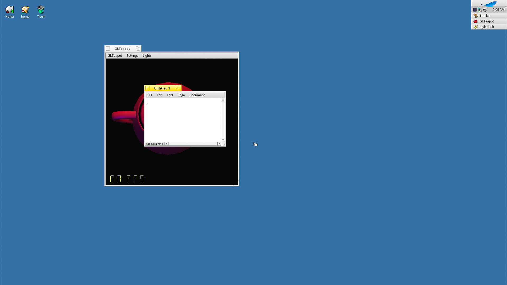

# haiku-amdgpu

Linux 6.12's `amdgpu` driver running unchanged on [Haiku](https://www.haiku-os.org/)
on a Linux compatibility layer, with libdrm, Mesa's radeonsi (OpenGL 4.6) and RADV
(Vulkan), and the Haiku desktop on the card through KMS.

**This is an experiment, not a product.** It was written almost entirely by an AI
(Claude, from Anthropic), directed by one developer who doesn't work in C, in a
couple of days, for fun. It has run on one graphics card. Nobody has reviewed the
code. It runs in the kernel, so a bug can crash the machine or damage data.

**This is not a contribution to Haiku**, and please don't submit any of it there:
Haiku doesn't accept AI-generated code. Any problem here is this project's, not
Haiku's.



## What works

On an RX 7900 GRE (Navi 31: GC 11.0.0, DCN 3.2):

- The desktop on the card, up to 5120x1440 at 240 Hz, with a hardware cursor
- OpenGL 4.6 in ordinary `BGLView` programs: GLTeapot, SuperTuxKart and Luanti run
- Vulkan through RADV, in windows through `vulkan_haiku.h`
- Drawing straight into the frame buffer for `BDirectWindow` programs, without
  the CPU copying pixels
- A tear-free desktop by page flipping (only with this repository's `app_server`,
  in a full image)

There is no video decoding, and only the first connected monitor is used. With
page flipping, a screenshot can show a frame that is one frame old.

## Known problems

**Don't use this on another card without reading this:**

- **Buffers that move corrupt memory.** A mapping into a program is made once and
  never updated (`unmap_mapping_range()` is empty in linuxkpi). If the kernel moves
  a mapped buffer, the program keeps writing to the old place, which may by then
  belong to something else. With 16 GiB of VRAM and Resizable BAR this has not shown
  up. A card with little VRAM, a 256 MiB BAR or an integrated GPU will likely hit it.
- **Only Navi 31 has run.** Code for GFX8 to GFX12 is built in, but only Navi 31's
  firmware is included, and the driver only touches the IDs on its device list.
  `/boot/home/config/settings/kernel/drivers/amdgpu` can change that (`devices 744c
  164e` or `devices all`). Laptops and hybrid graphics are not expected to work.
- **It depends on Haiku's kernel internals.** The driver uses private kernel
  interfaces, and a future nightly can break it with a kernel panic at boot. See
  [Haiku versions](#haiku-versions).
- **A panic looks like a freeze.** The kernel debugger doesn't draw on the card's
  screen, so everything just stops, including the mouse and Caps Lock.
- **There is an unexplained crash.** In about 35 boots in the VM, one panicked with
  a page fault in the kernel's `remove_images`, which suggests corrupted kernel
  memory, and one stopped during first boot. Neither came back in repeated runs, and
  the cause is unknown. It may well be this driver.
- `pkgman full-sync` removes `mesa_radeon` and puts Mesa 22 back.

If Haiku doesn't boot with this installed, hold Shift during boot and either pick
an earlier state under *Select package state*, or use *Select safe mode options* →
*Disable system components* and block `add-ons/kernel/drivers/bin/amdgpu`.

## Haiku versions

Tested in a VM with the card passed through, with official nightlies and
a monitor on the card at 1280x720:

| Nightly | Date | Result |
|---|---|---|
| hrev60317 | 2026-11-01 | Works |
| hrev60102 | 2026-09-14 | Works |
| hrev59998 | 2026-08-20 | Too old: the driver refuses to load, and the desktop stays on the frame buffer |

The driver refuses any kernel older than hrev60102, as those panic. `pkgman` can't
stop you from installing on one, as the `haiku` package counts as compatible back
to R1~alpha, and GL then doesn't work. Stable releases have not been tried: r1beta6
should be refused too, and would need its own build, as its kernel has a different
debug level.

## Building

You need a Linux machine and about 20 GB of disk, plus: `git`, `curl`, `gcc`, `g++`,
`make`, `cmake`, `pkg-config`, `python3` with `venv`, `nasm`, `bison`, `flex`,
`autoconf`, `automake`, `gawk`, `texinfo`, `glslangValidator`, `zlib`, `zstd` and
`mtools`. The list comes from one machine and may not be complete; Haiku's own
[build pre-requisites](https://www.haiku-os.org/guides/building/pre-reqs) cover the
Haiku part.

```bash
./setup.sh
```

```bash
./build.sh
```

`setup.sh` fetches Haiku, buildtools, Linux, Mesa, libdrm and the Vulkan loader and
headers at the exact versions used here, puts `patches/` on top, and fetches the
firmware. `build.sh` builds it all, which takes a while the first time, and leaves
four packages in `generated.x86_64/packages`.

## Installing on a Haiku nightly

Copy the four packages to the machine, in a Terminal in that folder, then reboot:

```bash
pkgman install ./amdgpu_linux-*.hpkg ./libdrm-*.hpkg ./mesa_radeon-*.hpkg ./vulkan_loader-*.hpkg
```

This replaces the system's `mesa`, `mesa_devel` and `mesa_swpipe`. To go back, use
`pkgman uninstall` on the four packages and install those again.

## A full image

An image includes this build's `app_server` with the tear-free desktop, and the test
programs (`amdgputest`, `gltest`, `kmstest`, `libdrmtest`, `tearingtest`, `vkheadless`,
`vkwindow`, `vsynctest`):

```bash
vm/baremetal-image.sh
```

```bash
vm/usb-image.sh <size of the disk in bytes>
```

Then `sudo vm/write-usb.sh /dev/sdX` for a USB stick or `sudo vm/write-disk.sh <serial>`
for an internal disk. **These erase the whole disk.** See
[docs/baremetal.md](docs/baremetal.md).

## In a VM

`vm/` runs Haiku in libvirt/QEMU with the card passed through, which is much nicer
for debugging: a freeze stays in the VM, and the serial log gets everything. The card
goes to `vfio-pci` at boot with `sudo vm/vfio-boot.sh install` and a reboot. Adjust the
PCI addresses in `vm/haiku-navi.xml` and `vm/vfio-boot.sh`, then:

```bash
NAVI_GPU=03:00.0 NAVI_BRIDGE=virbr0 vm/start.sh
```

`vm/nightly-vm.sh` does the same with an official nightly, and `vm/ssh.sh`,
`vm/push.sh`, `vm/stress.sh` and `vm/hangwatch.sh` drive and watch it. A connected
monitor on the card is needed for the desktop, page flipping and vsync; without one,
the desktop goes to the VM's virtual screen.

## What's where

| Path | What |
|---|---|
| `patches/haiku` | linuxkpi, the driver, the accelerant, `app_server`'s page flipping, test programs |
| `patches/mesa` | Haiku support in RADV and radeonsi, `BGLView`'s libGL, the Vulkan WSI |
| `patches/libdrm`, `patches/vulkan-*` | Haiku support |
| `port` | Build scripts, the list of Linux files, package definitions |
| `vm` | The VM, images and disks |
| `docs` | Work notes, in Danish: [the port](docs/amdgpu-port.md), [a real machine](docs/baremetal.md) |

## Licences

This repository's own scripts and notes are under the [MIT licence](LICENSE). The
patches are under the licences of what they change: MIT for Haiku and Mesa's parts,
and the others as in those projects. The driver is built from Linux's sources, so
a built `amdgpu_linux` package is covered by the GPL v2 as well. The firmware is
AMD's, under [its own licence](licenses/LICENSE.amdgpu), and isn't in this repository;
`setup.sh` fetches it from linux-firmware.
