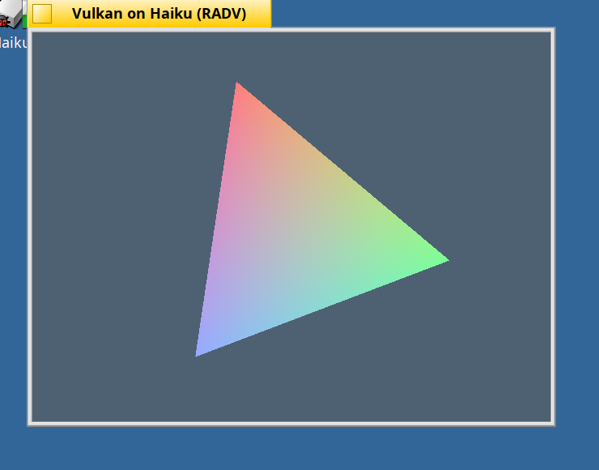
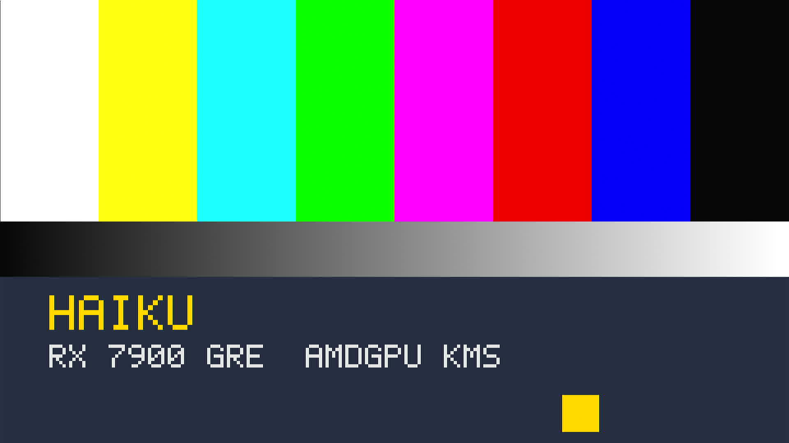
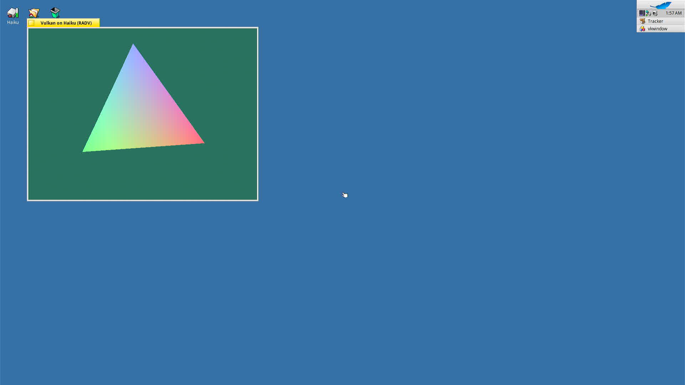
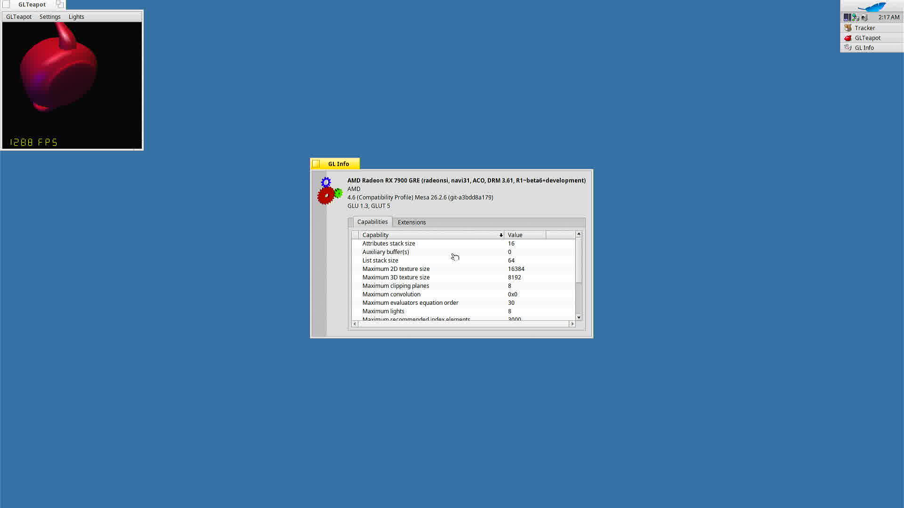
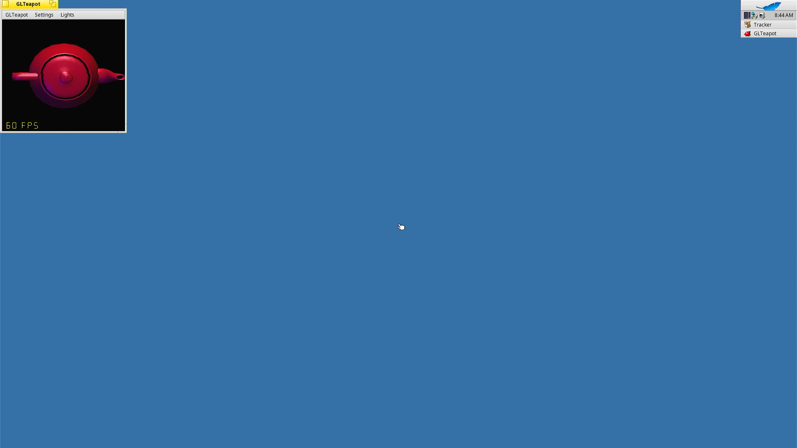
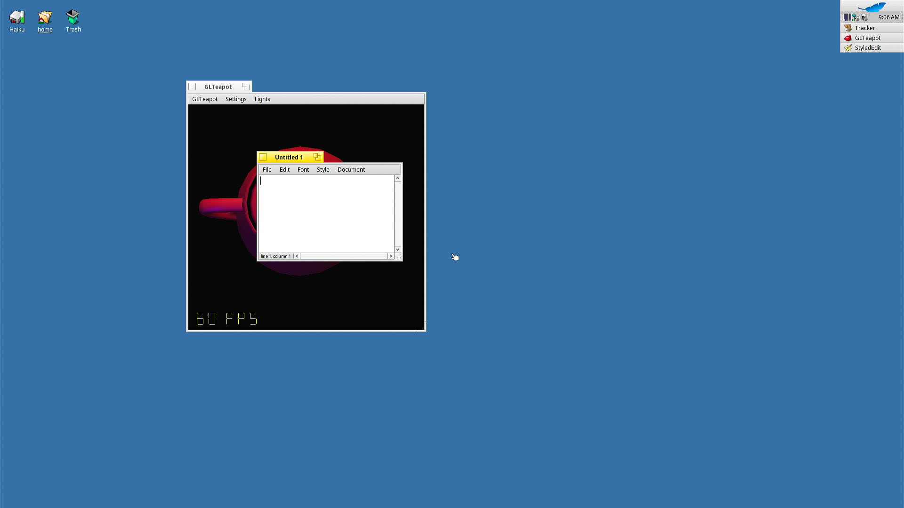
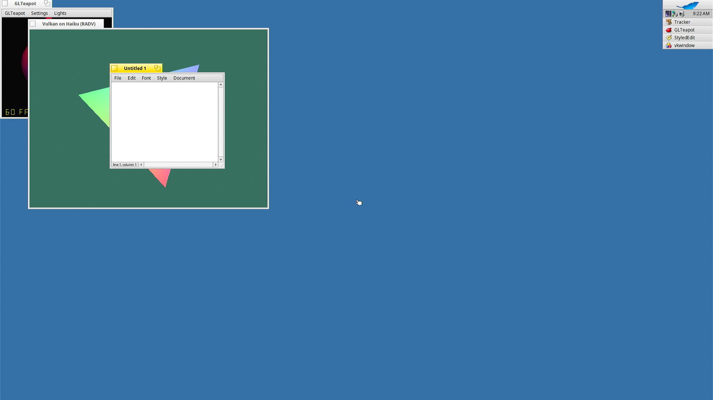
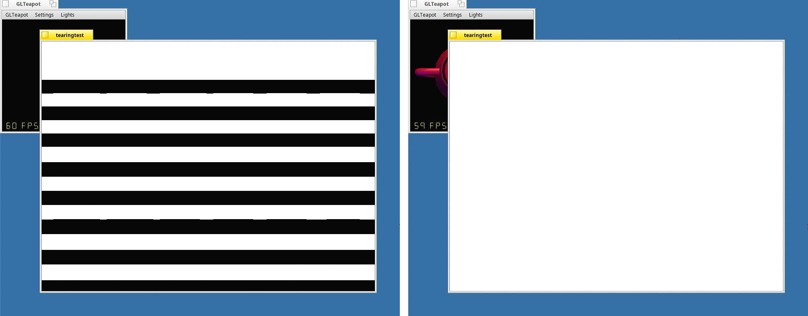

# Linux amdgpu på Haiku: analyse og køreplan

Skrevet 2026-10-31. Mål: RX 7900 GRE (Navi 31: GC 11.0.0, DCN 3.2, PSP/SMU 13.0.0)
med skærm og Mesa (radeonsi/RADV) på Haiku. Kun til eget brug.

## Kort konklusion

Den rigtige vej er at **portere Linux' amdgpu uændret oven på et Linux-
kompatibilitetslag i Haikus kerne**, sådan som FreeBSD gør (drm-kmod +
LinuxKPI). En egen implementering af amdgpu-interfacet er mulig for Mesa,
men giver ingen skærm og ender med at genskrive store dele af amdgpu alligevel.

Første mål er **amdgpu uden display (DC slået fra)**, dvs. en render-node,
som Mesa kan bruge headless. Displaydelen kommer bagefter.

## Hvad Linux-siden består af (målt i Linux 7.4-rc1)

| Komponent | Linjer |
|---|---|
| amdgpu (kerne) | 399.000 |
| Display Core + amdgpu_dm | 709.000 |
| Strømstyring (swsmu) | 187.000 |
| amd/include (uden register-headere) | 139.000 |
| DRM-kerne + display-hjælpere | 107.000 |
| TTM, scheduler, dma-buf | 27.000 |
| RAS | 20.000 |
| *Genererede register-headere* | *5.235.000* |
| *KFD (compute, udelades)* | *49.000* |

Omkring 1,5 mio. linjer skal oversættes. At skrive det om er udelukket; det
afgørende er kompatibilitetslaget:

- **392 forskellige system-headere** inkluderes, heraf 216 `<linux/...>`.
- **~2.150 kernefunktioner og makroer** kaldes udefra (groft estimat). De fleste
  er trivielle (`ARRAY_SIZE`, `le32_to_cpu`, `kfree`, logning). De tunge:

| Område | Antal | Eksempler |
|---|---|---|
| Sider og cache-attributter | 42 | `vmap`, `folio_*`, `set_pages_*` |
| DMA-mapping, scatter-gather | 34 | `dma_map_*`, `sg_*` |
| mmap og page faults | 16 | `vmf_insert_pfn`, `unmap_mapping_range` |
| Workqueues, kthreads | 28 | `queue_work`, `INIT_DELAYED_WORK` |
| Låse: ww_mutex, RCU | 20 | `ww_acquire_*`, `rcu_*` |
| sysfs, pm_runtime | 53 | kan stubbes |
| ACPI | 22 | mest laptop-funktioner, kan stubbes |
| debugfs, tracepoints | 29 | kan stubbes |
| Brugerpointere (hmm, mmu_notifier) | 12 | slås fra: `DRM_AMDGPU_USERPTR` |
| Filer og fds | 8 | `fd_install`, `anon_inode`, `poll_wait` |

- **FPU i kernen:** 36 DC-filer bruger flydende tal (DML) omkring
  `kernel_fpu_begin/end`. Haiku har intet tilsvarende. Det skal laves, og
  DML-filerne skal oversættes med SSE. Kræves kun til displaydelen.
- **Kan slås fra:** SI/CIK, ældre DCE-display, ACP-lyd, secure display, KUnit,
  userptr, KFD. **Små biblioteker der skal med:** I2C + i2c-algo-bit, CEC,
  HDMI/DP-hjælpere, interval-træer, CRC16, backlight, hwmon.

## Hvad andre har gjort

**FreeBSD (drm-kmod + LinuxKPI)** er den modne reference.
- LinuxKPI ligger i basissystemet: ~465 filer, ~65-75.000 linjer, BSD-licens
  (kan studeres og genbruges). drm-kmod rummer Linux-koden næsten uændret.
- Linux-ændringer er markerede `#ifdef __FreeBSD__` (27 filer i amd), driverlogik
  skrives aldrig om, og opdateringer afspilles commit for commit.
- Seneste version er 6.12 LTS. **RX 7900 GRE og XTX kører**, men der er stadig
  ustabilitet på RDNA3 (ring-timeouts, ASPM-relaterede page faults).
- Det svære: VM-integration (`struct page` = `vm_page`, PFN-indsættelse ved
  fejl, VRAM som "fictitious" hukommelse, cache-attributter), kernel-FPU,
  firmware som moduler. ReBAR, PCIe-atomics og PR3 er stubbet.
- Indsats: ca. én fuldtidsudvikler, 18 måneder bag Linux, kun LTS-versioner.

**Haiku**
- *X547 RadeonGfx* (userland-server, egen implementering af 22 ioctls): RADV og
  Zink kørte i 2021, men kun SI/Polaris, og projektet er dødt siden 2023.
- *X547 nvidia-haiku*: NVIDIA's open kernel-modul porteret som kernel-add-on,
  NVK direkte oven på. Den mest modne store GPU-port på Haiku i dag (alfa).
- *Haikus FreeBSD-netværkslag* (`src/libs/compat/freebsd_network`): et par
  hundrede KB shim bærer megabytes af uændret FreeBSD-kode. Det er modellen
  for byggeri og pakning af et Linux-lag.
- *airos-works/linux-drm* (oktober 2026, én udvikler, AI-genereret,
  ubekræftet): Linux 6.18 uændret + compat-lag på ~12-15.000 linjer som
  Haiku-kernel-add-on. Projektet påstår RADV på Polaris og GFX11 på en
  Phoenix-APU; intet om Navi 31. **Kun reference, ikke noget at bygge på.**
- Haikus egen holdning: ticket #16272 og GSoC-idéen "GPU acceleration" peger
  på et compat-lag. Intet DRM-arbejde er upstream.

**Mesa**
- RADV og radeonsi taler via et tyndt lag (`ac_drm_*`). Kritisk vej for
  vkcube/glxgears er **~20 ioctls**: amdgpu `INFO`, `GEM_CREATE/MMAP/VA/
  METADATA/OP/WAIT_IDLE`, `CTX`, `CS`, `WAIT_CS`, plus DRM `VERSION`,
  `GEM_CLOSE`, binære syncobjs (påkrævet), PRIME (kun til skærm).
- Kræver DRM-version ≥ 3.59 (Linux 6.11+). gfx11 kræver ikke user queues.
- **Ingen LLVM nødvendig:** RADV og radeonsi på gfx11 bruger ACO.
- På Haiku i dag: kun llvmpipe og lavapipe (HaikuPorts mesa 25.3.6), ingen
  libdrm-port, ingen Vulkan-WSI upstream. X547's VideoStreamsWsi giver WSI.

## Vejene

| | A: Porter amdgpu (anbefalet) | B: Egen amdgpu-UAPI | C: Egen display-kode |
|---|---|---|---|
| Skærm | Ja (DC) | Nej | Ja, én fast tilstand |
| Mesa | Ja, uændret | Ja, ~20 ioctls | Nej |
| Arbejde | Compat-lag (VM er det svære) | GPUVM, MES/KIQ-ringe, IH, fences, allokator selv | DMCUB, ure, DCN, VBIOS-tabeller |
| Hardware-quirks | Arves fra Linux | Skal findes selv | Skal findes selv |
| Fremtid | Følg Linux LTS | Vedligeholdes alene | Blindgyde |

B lyder mindre, men bag de 20 ioctls ligger netop det, amdgpu gør på gfx11
(GPU-sidetabeller, MES- og RLC-firmware via PSP, interrupts). Den kode ville
man ende med at kopiere fra Linux alligevel.

## Køreplan for A

**Valg:** Linux **6.12 LTS** som kilde (samme version som FreeBSD's drm-kmod,
så deres `__FreeBSD__`-ifdefs kan bruges som kort over, hvor OS-specifikt
arbejde er nødvendigt). Kernel-add-on, ikke userland-server: VM-crashes er
billige i vores opsætning. Byggeri og struktur som Haikus FreeBSD-netværkslag.
Linux-filer importeres uændret; ændringer markeres `#ifdef __HAIKU__`.

0. **Gjort:** native driver (registrering, IP discovery, VRAM, framebuffer,
   PSP/SMU), VM-værksted med robust reset-loop, capture.
1. **Skelet der linker:** DRM-kerne, TTM, scheduler, dma-buf og amdgpu med
   `DRM_AMD_DC=n`, oversat som Haiku-add-on med tomme compat-headere. Listen
   over manglende symboler ved link er den reelle opgaveliste.
2. **Compat-kerne:** hukommelse (kmalloc, vmalloc, sider, DMA uden IOMMU i
   gæsten), låse (mutex, spinlock, ww_mutex, RCU), workqueues og timere,
   xarray/idr, PCI og MSI, firmware fra filer. Mål: amdgpu kommer igennem
   init med PSP, SMU, GMC, IH, GFX og SDMA, og ring-tests består.
3. **`/dev/dri` og mmap:** render-node, ioctls uændret igennem, GEM-mmap via
   Haiku-areas med fejlhåndtering. libdrm-port. `amdgpu_test` fra libdrm.
4. **Mesa headless:** RADV (vulkaninfo, compute) og radeonsi offscreen.
5. **Display:** kernel-FPU, DC slået til, en KMS-accelerant til app_server
   (accelerant-hooks oversat til DRM-modesetting), billede på HDMI.
6. **På skærmen:** Vulkan-WSI (VideoStreamsWsi), Zink/radeonsi i vinduer.

Den native driver bliver ved som diagnoseværktøj; dens PSP/SMU-kode erstattes
af amdgpu's egen.

## Status

**Fase 1 (2026-11-01): færdig.** Linux 6.12.115 (`linux-6.12/`, uændret import)
oversættes mod linuxkpi (`haiku/src/libs/compat/linuxkpi/include`, ~250 egne
headere, MIT) plus nogle rene Linux-headere stillet igennem
(`port/passthrough-headers.txt`).

- 418 filer: DRM-kerne, TTM, scheduler, dma-buf, display-hjælpere, amdgpu og
  swsmu med `DRM_AMD_DC=n`, samt `lib/xarray.c`, `idr.c`, `rbtree.c`,
  `radix-tree.c`, `bitmap.c`, `drivers/gpu/buddy.c`, `drivers/video/hdmi.c` og
  `i2c-algo-bit.c`. Alle oversætter.
- Samlet link (`port/link-check.sh`): 404 udefinerede symboler, sorteret efter
  område i `port/phase1-undefined.md`. Det er fase 2's opgaveliste.
- Værktøjer: `port/kbuild-files.sh` (fil-listen fra Kbuild med `port/config.mk`),
  `port/cc.sh` (én fil), `port/build-all.sh` (alle + opsummering af fejl),
  `port/kpi-hdr.sh` (ny linuxkpi-header).
- Erfaringer: Linux-headere regner med lange transitive include-kæder; dem
  efterligner linuxkpi bevidst. Kernel-headere, linuxkpi mangler, falder stille
  tilbage på UAPI-versionen; tjekkes med `-MM` (se fase 1-loggen).
- Ikke gjort endnu: Jam-integration som rigtig Haiku-add-on, og ingen af de
  404 funktioner er implementeret.

**Fase 2 (2026-11-01): amdgpu prober kortet på Haiku.** Kernel-add-on'en
`amdgpu` (`src/add-ons/kernel/drivers/graphics/amdgpu`, 5,9 MB) linker uden
udefinerede symboler og initialiserer RX 7900 GRE i VM'en: IP discovery,
VBIOS fra ROM (via SMUIO), 16 GiB VRAM, GART, PSP, SMU, GFX/compute/SDMA/
VCN/JPEG/MES-ringe, IB-test bestået på gfx, compute og sdma, "Initialized
amdgpu 3.61.0". Ingen linuxkpi-stubs blev ramt undervejs.

- linuxkpi er delt i en Linux-side (`linuxkpi/linux/*.c`, oversat som
  Linux-kode) og en Haiku-side (`linuxkpi/haiku/*.cpp`), forbundet af den
  rene C-grænse `include/linuxkpi/haiku.h`.
- Spinlocks er Haiku-mutexer: Linux' interrupt-handlere og timere kører i
  tråde (Haiku-handleren frigiver kun en semafor), så intet tager dem i
  interrupt-kontekst. Det kræver MSI.
- Tasks: en `task_struct` pr. Haiku-tråd; `schedule()`/`wake_up_process()` på
  en semafor pr. task. Timere, hrtimere og irq_work kører i én timer-tråd;
  workqueues har egne tråde. RCU med to epoker.
- Sider: blokke af 2^orden (orden 0 fra kernel-heapen, større som
  sammenhængende areas), hashet på pfn. DMA-adresse = fysisk adresse.
- Add-on'en linkes med `-Bsymbolic`: Haikus loader binder ellers globale
  symboler til kernens først (Linux' `vsnprintf()` blev til Haikus).
- Driver-valg i `config/UserBuildConfig` (`AMDGPU_DRIVER = linux|native`);
  Linux-driveren ligger i `/dev/misc` og indlæses af `vm/navi-dev.sh`.
- Mangler: brugerflade (DRM-ioctls/device-node, mmap af BO'er), DC
  (display), shrinkers, signaler, sysfs/hwmon.

**Fase 3 (2026-11-01): brugerfladen virker.** `/dev/dri/card0` og
`/dev/dri/renderD128` udgives og går direkte til Linux' file operations
(open, flush, release, ioctl, read). `amdgputest` (src/bin) bruger den
uændrede Linux-UAPI og består på begge noder: version, device/memory-info,
firmware, sensorer (39 °C, clocks), kontekster, BO create/map/VA/close, og
en SDMA-kopi af 1 MiB fra VRAM til GTT via CS-ioctl'en og WAIT_CS (4,5 ms),
kontrolleret ord for ord fra CPU'en.

- Char devices: `register_chrdev()` husker majors; `device_add()` på en
  device med `devt` giver en node under den sti klassen siger (DRM:
  `dri/...`). Driverens hooks kalder `linuxkpi_chrdev_*()`.
- mmap: Haiku har ingen mmap for devices, så `LINUXKPI_IOCTL_MMAP`
  (`include/linuxkpi/uapi.h`) kalder filens `mmap()`, kører fault-handleren
  for hver side (indsatte sider samles i vma'en) og laver én area i det
  kaldende team med den cache-type Linux bad om (VRAM: write-combining).
  `LINUXKPI_IOCTL_MUNMAP` kalder vma'ens `close()`.
- Fundet undervejs: Haikus memory-type ligger i `addressSpec`, ikke i
  `protection`; uden den mapper `map_physical_memory()` uncached, og to
  areas over samme fysiske hukommelse med forskellig type giver panic.
- Mangler: mappinger der følger BO'er når TTM flytter dem
  (`unmap_mapping_range()`), poll/select på DRM-filer, oprydning når et team
  dør uden munmap, Haiku-signaler; libdrm-port (drmMmap via ioctl'en).

## Risici

- **Haikus VM-system** er den største ubekendte: PFN-indsættelse ved fejl i
  areas, cache-attributter pr. side, VRAM-BAR som enhedshukommelse. Skal
  undersøges i Haikus kilde, før fase 2.
- **Kernel-FPU** skal laves i Haiku (gem/gendan FPU-tilstand, ingen
  preemption) til fase 5.
- **Omfang:** FreeBSD bruger én fuldtidsudvikler og er 18 måneder bagud.
  Regn med måneder for fase 1-3.
- **RDNA3 er ikke helt stabil** selv på FreeBSD.
- **Licens:** dele af DRM og dma-buf er GPL-2.0; fint til eget brug.

## Kilder

- FreeBSD: https://github.com/freebsd/drm-kmod,
  https://github.com/freebsd/freebsd-src/tree/main/sys/compat/linuxkpi,
  https://github.com/freebsd/drm-kmod/wiki/Porting-a-new-version-of-DRM-drivers-from-Linux,
  https://www.freebsd.org/status/report-2025-04-2025-06/drm-drivers/,
  https://forums.freebsd.org/threads/amd-radeon-7900xtx-unsupported.92057/latest,
  https://github.com/freebsd/drm-kmod/issues/413
- Haiku: https://dev.haiku-os.org/ticket/16272,
  https://www.haiku-os.org/community/gsoc/2025/ideas/,
  https://github.com/haiku/haiku/tree/master/src/libs/compat/freebsd_network,
  https://discuss.haiku-os.org/t/libdrm-now-officially-supports-2-operating-systems-upstream/9416
- X547: https://github.com/X547/RadeonGfx, https://github.com/X547/libdrm2,
  https://github.com/X547/nvidia-haiku, https://github.com/X547/VideoStreamsWsi,
  https://github.com/X547/mesa,
  https://www.phoronix.com/news/Haiku-OS-Zink-RADV
- airos: https://github.com/airos-works/linux-drm
- Mesa/libdrm: https://gitlab.freedesktop.org/mesa/mesa (`src/amd/common/ac_linux_drm.c`,
  `ac_gpu_info.c`), https://gitlab.freedesktop.org/mesa/drm,
  https://github.com/haikuports/haikuports/blob/master/sys-libs/mesa/mesa-25.3.6.recipe

**libdrm (2026-11-01): porteret.** libdrm 2.4.134 (`libdrm/`, egen git,
gren `haiku`, kun lokalt) bygges af Haikus Jam (`src/libs/libdrm`) til
`libdrm.so` og `libdrm_amdgpu.so` i `/boot/system/non-packaged/lib`, med
`amdgpu.ids` i `non-packaged/data/libdrm`. `libdrmtest` (src/bin) består:
`drmGetDevices2` med PCI-ids og begge noder, node-navne og -type,
`amdgpu_device_initialize` ("AMD Radeon RX 7900 GRE"), GPU/heap-info,
buffere med CPU-mapping, og en SDMA-kopi på 4 MiB via `amdgpu_cs_submit`.

- Haiku-delen (`libdrm/haiku/`): en node fortæller sin Linux-dev_t og sin
  PCI-enhed via `LINUXKPI_IOCTL_DEVICE_INFO`; `stat()`/`fstat()`-wrappere
  udfylder `st_rdev`, og libdrms egne grene for subsystem/PCI (som på
  OpenBSD) spørger noden. `drm_mmap()`/`drm_munmap()` bruger linuxkpis
  ioctls; munmap husker hvilken fd mappingen kom fra.
- Driveren åbner først Linux-filen ved første rigtige brug, så det koster
  ingen DRM-fil (og GPU-VM) at spørge en node hvem den er.
- Positive POSIX-fejl (`B_USE_POSITIVE_POSIX_ERRORS` +
  `libposix_error_mapper.a`, før libroot på link-linjen): libdrm returnerer
  `-errno` som på Linux.
- Ikke understøttet endnu: dma-buf/sync-file-fd'er (PRIME, syncobj-export),
  da linuxkpi ikke laver fd'er.
- Sidegevinst-fund: uden framebuffer (ingen option-ROM, Linux-driveren uden
  DC) kan app_server ikke starte, og net_server crasher i debuggeren; det er
  derfor VM'ens netværk ikke kommer op i Linux-tilstand.

**Mesa/RADV (2026-11-01): Vulkan-compute kører.** Mesa 26.2.6 (`mesa/`,
egen git, gren `haiku`, kun lokalt) krydsbygges af `port/mesa-build.sh`
(meson/ninja/mako i `tools/venv`, Haikus cross-gcc, sysroot fra
`haiku_cross_devel_sysroot` + gcc-syslibs, libdrm via
`port/libdrm-sysroot.sh`). Kun RADV (ACO, ingen LLVM), ingen WSI.
`vkheadless` (src/bin) indlæser `libvulkan_radeon.so` via ICD-interfacet:
"AMD Radeon RX 7900 GRE (RADV NAVI31), Vulkan 1.4.354", device, buffer i
VRAM med CPU-mapping, compute-pipeline (ACO, 2 ms), 1M invocations på
2,9 ms, alle resultater rigtige.

Mesa-ændringer (`haiku`-grenen):
- Haiku med på listen over systemer med DRM (så libdrm bruges).
- `simple_mtx` på libroots user mutex: ingen futex på Haiku, og Haikus
  pthread-mutexer er ikke gyldige nulstillede, hvad Mesa regner med.
- BO-mappinger via libdrms `drmMap()`/`drmUnmap()` (linuxkpis ioctl);
  placed mappings (`MAP_FIXED`) understøttes ikke endnu.
- DRM-nodernes dev_t udledes af navnet (libdrms Haiku-kodning).
- Bygges med positive POSIX-fejl + error mapper, og `-lbsd` for
  `dl_iterate_phdr()` (build-id → cache-UUID).

Mangler: Vulkan-loader og ICD-json, WSI (vindue/skærm), shader-cache
(zlib/zstd), radeonsi (OpenGL; kræver libelf), dma-buf/sync-file-fd'er.

**Vulkan-loader og WSI (2026-11-01): Vulkan i et Haiku-vindue.** Khronos'
Vulkan-Loader og -Headers 1.4.367 (`vulkan-loader/`, `vulkan-headers/`, egne
git, gren `haiku`, kun lokalt) krydsbygges af `port/vulkan-loader-build.sh`
(CMake-toolchain `port/haiku-toolchain.cmake`). RADV findes via
`/boot/system/non-packaged/data/vulkan/icd.d/radeon_icd.x86_64.json`.
`vkwindow` (src/bin) tegner en roterende trekant i et vindue gennem
loaderen: ~640 billeder/s i 640x480.

- Overfladen: der findes ingen registreret Haiku-overflade i Vulkan, så
  `vulkan_haiku.h` definerer `VkHaikuViewSurfaceCreateInfoHAIKU` (et
  `BView*`), som kædes på `VkHeadlessSurfaceCreateInfoEXT`. Loaderen lader
  den passere (lille patch), og Mesas headless-WSI præsenterer i viewet,
  når den er der. Strukturtypen (1000999000) er lokal for porten.
- Præsentation: CPU-billeder (GPU'en blitter til en lineær buffer), vent på
  blit-fencen, kopier rækkerne til en `BBitmap` og `DrawBitmap()` med
  vinduet låst. Ingen vsync endnu; FIFO kører så hurtigt kopien tillader.
- Loader-port: Haiku som Unix-platform, eksekverbar sti fra teamets
  app-image, ingen libm, BSD-fallback for `secure_getenv()`.

Mangler: rigtig registreret Haiku-overflade (SDL m.fl. kender ikke
strukturen), vsync/præsentationstiming, vinduesstørrelser der ændres,
og en nul-kopi-vej (direkte til skærmen) når DC er på.

**Display (2026-11-01): billede på kortets egen udgang.** `CONFIG_DRM_AMD_DC`
er slået til (877 filer i alt, heraf 459 i DC; `port/files.txt`). Med
`dcn_3_2_0_dmcub.bin` initialiserer amdgpu "Display Core v3.2.301 on DCN
3.2", og DRM melder fire connectors (to HDMI, to DP). `kmstest` (src/bin)
finder den tilsluttede HDMI-A-1, sætter 1920x1080@60 via libdrm
(dumb buffer, `drmModeAddFB`, `drmModeSetCrtc`, 73 ms) og animerer et
testbillede, som capture-donglen viser:

- DC krævede næsten intet nyt af linuxkpi: `linux/fpu.h`, backlight-flag og
  to per-CPU-makroer. Kernel-FPU-sektioner (DML) beskyttes ikke på Haiku,
  hvis kerne gemmer FPU'en ved hver indgang og selv bruger SSE.
- Mangler: et accelerant så app_server (Haiku-skrivebordet) kører på kortet,
  vsync/page flip fra brugerland, flere skærme, lyd over HDMI.

**Skrivebordet på kortet (2026-11-01).** app_server kører nu på 7900 GRE'ens
egen HDMI-udgang. Driveren ligger i `/dev/graphics` (indlæses af app_server
ved boot) og udgiver `/dev/graphics/amdgpu_kms_0`: DRM-primærnoden under et
andet navn, som peger på `amdgpu_kms.accelerant`
(`src/add-ons/accelerants/amdgpu_kms`). Accelerantet bruger libdrms KMS på
app_servers fd: modes og EDID fra den tilsluttede connector, en dumb buffer i
VRAM som framebuffer, `drmModeSetCrtc`. app_server foretrækker det frem for
`vesa`/`framebuffer`, så VM'ens virtuelle VGA er kun reserve.

Vulkan-vinduet (RADV) på skrivebordet, alt på samme kort:

- app_server er DRM-master på `card0`; testprogrammer bruger `renderD128`
  (`kmstest` kræver master og køres ikke længere ved boot).
- Mangler i accelerantet: kloner (BWindowScreen), DPMS, skift af
  skærm/flere skærme, og 2D-acceleration. (Cursor og vsync: se nedenfor.)

**OpenGL (2026-11-01): radeonsi kører.** Samme Mesa-build bygger nu også
radeonsi (ACO, ingen LLVM) med EGL og GLES: `libgallium-26.2.6.so`,
`libEGL.so.1`, `libGLESv2.so.2` i `/boot/system/non-packaged/lib`.
`gltest` (src/bin) bruger EGL's surfaceless-platform (render-noden via
libdrm): "AMD Radeon RX 7900 GRE (radeonsi, navi31, ACO, DRM 3.61)",
OpenGL 4.6 Core Profile, GLSL 4.60; en trekant i et FBO læses tilbage med
de rigtige farver, og fill rate måles til ~250-300 Gpixels/s.

- radeonsi kræver libelf (Mesas `ac_rtld`); Haiku har ingen, så
  `port/libelf-mini/` er en lille, skrivebeskyttet libelf (MIT) til ELF64 i
  hukommelsen, med lige det Mesa bruger, bygget statisk ind i sysrooten.
- Mesas egen `libsync.h` fik samme Haiku-rettelse som libdrms.
- Advarsel uden betydning: `os_same_file_description` kan ikke afgøre om
  to fd'er deler fil-beskrivelse på Haiku.

**GL i vinduer (2026-11-01): BGLView på radeonsi.** Mesa-træet har fået
`src/haiku-gl/`: en ny `libGL.so.1` med Haikus BGLView-ABI (headeren er
kopieret fra Mesa 22-pakken), bygget på EGL (surfaceless) og radeonsi.
Den ligger i `/boot/system/non-packaged/lib` og skygger derfor for
systemets Mesa 22-libGL, så uændrede programmer som GLTeapot og GLInfo
kører på kortet. GLTeapot startes ved boot og står på skrivebordet.

- Hver BGLView har en EGL-pbuffer i viewets størrelse; `LockGL()` gør
  konteksten aktuel, `SwapBuffers()` læser billedet med `glReadPixels`
  ind i en BBitmap og tegner den med `DrawBitmap`. GL-funktionerne
  eksporteres via `libglapi_bridge` og deler dispatch med libgallium.
- Prisen er en kopi GPU→CPU→app_server pr. frame; GLTeapot når alligevel
  ~1300-2200 FPS. Der er ingen vsync.
- Mesa 22's renderer-add-ons (BGLRenderer/GLRendererRoster, "Software
  Pipe") bruges ikke længere; `BGLScreen` (fuldskærm) er en stub.
- Mangler: EGL-platform for Haiku-vinduer, glvnd. (Zero-copy: se
  "Direkte GL" nedenfor.)

**Cursor og vsync (2026-11-01).** Accelerantet bruger nu CRTC'ens
cursor plane: `B_SET_CURSOR_BITMAP` (B_RGBA32, omregnet til den
præmultiplicerede alfa DC vil have) og `B_SET_CURSOR_SHAPE` (BeOS'
monokrome cursorer) skriver i en 64x64 dumb buffer (DCN 3.2's grænse,
læst med `DRM_CAP_CURSOR_WIDTH`), og `B_MOVE_CURSOR` er en
`drmModeMoveCursor`. app_server tegner derfor ikke længere cursoren i
framebufferen.

`B_ACCELERANT_RETRACE_SEMAPHORE` giver en semafor, som en tråd frigiver ved
hver vblank (`drmWaitVBlank` på CRTC'en, dvs. DC's vblank-interrupt via
linuxkpi). Tråden startes først når nogen beder om semaforen.
`BScreen::WaitForRetrace()` virker dermed: `vsynctest` (src/bin) måler
60,00 Hz, og en BGLView med `SwapBuffers(true)` (venter på retrace før
billedet sendes til app_server) kører med 59,8 fps. GLTeapots "Limit FPS"
(slået til som standard) bruger samme semafor, så den kører nu 60 FPS i
stedet for ~2000.

- app_server selv tegner stadig direkte i den viste framebuffer uden at
  vente på vblank; helt tearing-frit skrivebord kræver page flip og en
  app_server, der ved hvornår et billede er færdigt. (Løst: se
  "Tearing-frit skrivebord" nedenfor.)
- Vulkan-WSI'ens FIFO-mode venter ikke på vblank endnu. (Nu gør den: se
  "Vulkan direkte" nedenfor.)

**Direkte GL uden kopi (2026-11-01).** En BGLView i en BDirectWindow
(GLTeapot er en) sender nu sine billeder direkte til skærmen på GPU'en,
uden at CPU'en rører pixels:

1. **dma-buf-fd'er i linuxkpi.** Linux-filer der ikke er device-noder
   (dma-bufs, sync files) er rigtige Haiku-fd'er på driverens nye node
   `/dev/misc/linuxkpi/file`. `get_unused_fd_flags()` åbner noden i den
   kaldende team med `vfs_open_vnode()`, `fd_install()` giver den filen, og
   `fget()` finder filen igen via `get_fd()` og nodens vnode. Dermed
   virker PRIME (`DRM_IOCTL_PRIME_HANDLE_TO_FD`/`FD_TO_HANDLE`), syncobj- og
   sync file-fd'er og dma-bufs egne ioctls, som på Linux.
   `alloc_file_pseudo()` laver nu en dentry med filsystemets dentry-ops,
   da dma-buf frigiver sine buffere i `d_release`.
2. **libdrm:** `DRM_CLOEXEC`/`DRM_RDWR` oversættes til Linux' værdier i
   `drmPrimeHandleToFD`, og libdrm_amdgpu spørger
   `LINUXKPI_IOCTL_FILE_SIZE` om en dma-bufs størrelse (Haikus `lseek()`
   kan ikke). Mesa slår dmabuf-caps til på Haiku (`u_screen.c`), og WSI
   bruger kun dma-buf-implicit sync for billeder der har en dma-buf.
3. **BGLView:** CRTC'ens scanout-buffer hentes fra `card0` (uden at være
   master: `drmModeGetCrtc` → `drmModeGetFB` → PRIME), importeres som
   EGLImage (`EGL_EXT_image_dma_buf_import`, XRGB8888, lineær) bag en
   renderbuffer, og `SwapBuffers()` laver en `glBlitFramebuffer` fra
   pbufferen direkte ind i framebufferen, klippet til de synlige
   rektangler fra `DirectConnected()`. `glFinish()` før låsen slippes
   sikrer, at `B_DIRECT_STOP` først returnerer når intet mere lander.

`libdrmtest` tjekker PRIME mellem to DRM-filer og eksporten af
scanout-bufferen; `vsynctest` måler bitmap-vejen til ~2300 fps og direkte
mode til ~4700 fps, og læser billedet tilbage fra skærmen.

- Kun BDirectWindow-programmer får direkte mode; andre BGLViews (GLInfo,
  almindelige BWindows) bruger stadig bitmap-vejen.
- `Draw()` maler intet i direkte mode, så et GL-program der ikke tegner
  løbende, viser først noget igen ved næste `SwapBuffers()`.
- `glFinish()` pr. billede lader CPU'en vente på GPU'en.
- `poll()`/`select()` på dma-buf- og sync file-fd'er virker ikke endnu
  (noden har ingen select-hook).
- Fd-opslaget bygger på devfs' private cookie-layout (enheds-cookien
  først).

**Vulkan direkte (2026-11-01).** Samme vej for Vulkan:

- Swapchains til en Haiku-view bruger nu GPU'ens egne billeder (native
  `WSI_IMAGE_TYPE_DRM`, `TRANSFER_SRC`), og hver present kopierer billedet
  ud på present-køen med `vkCmdCopyImageToBuffer` efter den rendering, den
  venter på. Den gamle CPU-vej (WSI-blit til lineær buffer, CPU-kopi)
  er erstattet af en GPU-kopi til en staging-buffer.
- **Direkte:** skærmens framebuffer importeres som `VkBuffer` over en
  dma-buf (`VK_EXT_external_memory_dma_buf`), og kopien går direkte derind,
  én region pr. synligt rektangel, med pitch som `bufferRowLength`.
- **API:** et BDirectWindow-program sender sine `DirectConnected()`-kald
  videre til `vkDirectConnectedHAIKU(device, view, info)` (fra
  `vkGetDeviceProcAddr`, i `vulkan_haiku.h`). Viewet, ikke `VkSurfaceKHR`,
  er nøglen, da loaderen ikke oversætter surface-handles for kommandoer den
  ikke kender. Mesas runtime svarer på navnet; loaderen sender ukendte
  device-kommandoer uændret videre.
- **FIFO** venter på vblank (retrace-semaforen) før kopien; **IMMEDIATE**
  gør ikke. Haiku-views tilbyder netop de to.
- WSI'en tilføjer ikke længere dma-buf-implicit sync til billeder, som kun
  den selv læser.

`vkwindow` (nu en BDirectWindow, med `immediate` og `plain` som valg)
måler direkte ~1400 fps, via viewet ~900 fps, og 60 fps med FIFO.

- Et program skal selv være en BDirectWindow og videresende; ellers går
  presents gennem viewet som før.
- Hver present venter på sin kopi (fence), så CPU og GPU ikke overlapper
  over en present.

**Tearing-frit skrivebord (2026-11-01).** Page flip mellem to skærme:

- **Accelerantet** tager nu en mode der er dobbelt så høj som skærmen
  (`virtual_height`, den klassiske Haiku-måde): én dumb buffer med en
  KMS-framebuffer for hver halvdel (`drmModeAddFB2` med offset), og
  `B_MOVE_DISPLAY` til toppen af en halvdel er et `drmModePageFlip`, der
  venter på flip-eventet (via `read()` på DRM-filen) før det returnerer.
  Det melder sig med en privat feature, `B_ACCELERANT_PAGE_FLIP_FEATURE`
  (`headers/private/graphics/common/page_flip.h`), så andre accelerants med
  `B_MOVE_DISPLAY` ikke pludselig bruges sådan.
- **app_server** tegner som før i sin back buffer i RAM, men i flip-mode
  noterer `_CopyBackToFront()`/`_CopyToFront()` kun hvad der er ændret.
  En flip-tråd kopierer, med eksklusiv lås, ændringerne siden sidst plus
  dem den skjulte halvdel missede sidste gang ind i den skjulte halvdel og
  flipper ved næste vblank: højst ét billede pr. refresh, aldrig skrivning
  i det viste billede. `TEAR_FREE=0` i app_servers miljø slår det fra.
- **Direkte GL og Vulkan** skriver hvert billede i begge halvdele (bufferens
  størrelse, fra `LINUXKPI_IOCTL_FILE_SIZE`, siger om der er to), så den
  næste viste halvdel altid har dem.

`tearingtest` (src/bin) skifter et 800x600-vindue mellem sort og hvidt så
hurtigt app_server kan. Fanget fra kortets HDMI: før var 15 af 15 billeder
stribede (revet), nu er 0 af 15, mens billederne stadig skifter. app_server
tegner samtidig ~4 gange hurtigere (162.000 mod 41.000 fyld på 20 s), da
tegning ikke længere venter på skrivning i VRAM.

- Direkte vinduer kan stadig rive inden for sig selv, da de også skriver
  i den viste halvdel.
- BWindowScreen-programmer, der selv bruger `B_MOVE_DISPLAY`, er ikke
  afprøvet sammen med flip-tråden.
- Ændringer når skærmen op til ét billede (~16 ms) senere end før.

**hpkg-pakker (2026-11-01).** Alt ligger nu i fire Haiku-pakker i stedet
for løse filer i `non-packaged`, bygget af `port/build-packages.sh` (med
host-værktøjet `package create`) ud fra `port/packages/*.PackageInfo`, til
`generated.x86_64/packages/`:

| Pakke | Indhold |
|---|---|
| `amdgpu_linux-6.12.115-1` | driveren (`drivers/bin/amdgpu` + link i `dev/graphics`), `amdgpu_kms.accelerant`, Navi 31-firmware i `data/firmware/amdgpu` |
| `libdrm-2.4.134-1` | `libdrm.so`, `libdrm_amdgpu.so`, `data/libdrm/amdgpu.ids` |
| `mesa_radeon-26.2.6-1` | libgallium (radeonsi), libEGL, libGLESv2, libGL med BGLView, RADV + ICD-manifest |
| `vulkan_loader-1.4.367-1` | `libvulkan.so.1` |

- Billedet lægger dem i `system/packages` med `AddPackageFilesToHaikuImage`,
  så de tæller med, når afhængigheder løses: `mesa_radeon` giver
  `lib:libGL`/`lib:libEGL`/`lib:libGLESv2`, som `glu` og `haikuwebkit`
  kræver, og `conflicts`/`replaces` den gamle `mesa`/`mesa_swpipe`.
- Haikus top-`Jamfile` tilføjede Mesa 22 (`mesa`, `mesa_devel`,
  `mesa_swpipe`) direkte; det sker nu kun, når `HAIKU_IMAGE_OWN_MESA` ikke
  er sat (UserBuildConfig sætter den).
- Stierne er flyttet med: libdrm læser `/boot/system/data/libdrm/amdgpu.ids`,
  ICD-manifestet peger på `/boot/system/lib/libvulkan_radeon.so`; driverens
  firmware og loaderens data søges stadig først i `non-packaged`, så man kan
  lægge en nyere version ovenpå.
- Boot-testen består uændret, og `non-packaged` er tom.
- Mangler: devel-pakker (headers til libdrm, Mesa, Vulkan), strippede
  biblioteker (libgallium er 30 MB med symboler), og en pakkekilde så
  `pkgman` kan opdatere dem. Testprogrammerne ligger stadig i haiku-pakken.

**Klar til maskinen selv (2026-11-01).** Se [baremetal.md](baremetal.md):
billedet starter fra USB via UEFI. Driveren tager kun enheder på sin liste
(default Navi 31, 1002:744c; settings-filen `amdgpu` med `devices ...`), så
maskinens Raphael-iGPU (1002:164e, også amdgpu) ikke røres. `navi-dev.sh`
skriver sin rapport til `/boot/home/navi-report.txt`, som
`vm/read-usb-report.sh` henter fra Linux bagefter. `vm/write-usb.sh`
skriver nøglen (kun hele, umonterede USB-diske, med bekræftelse).

**GL der sad fast ved flytning (2026-11-01).** På maskinen selv kunne GL-delen
af GLTeapot blive tegnet videre på den gamle plads, mens vinduet viste et
frosset billede. Syslog: `GLTeapot killed for a problem in DirectConnected():
Operation timed out`. Årsagen var en deadlock i BGLView, som app_server brød
efter sin timeout på et halvt sekund:

1. Under en flytning falder billederne tilbage på bitmap-vejen, og
   `DrawBitmap()` venter på app_server (`Sync()`) med `fDrawLock` holdt.
2. app_server holder skrivebordets lås og venter på `DirectConnected()`.
3. `DirectConnected()` venter på `fDrawLock`.

Efter timeouten sletter app_server vinduets direkte forbindelse, så programmet
aldrig mere hører om flytninger, og blittet fortsætter med de gamle
koordinater.

- **Rettelsen:** den direkte tilstand har sin egen lås
  (`glview_state::directLock`), som aldrig holdes, mens der ventes på
  app_server.
- **Sikkerhedsnet uden ændringer i Haiku:** hvis app_server alligevel giver op,
  sletter den semaforerne, og `BDirectWindow`s daemon dør. `DirectConnected()`
  kører i den tråd, så `BGLView` og Vulkan-WSI'en husker dens id og tjekker med
  `get_thread_info()` før hvert billede. Er den væk, går billederne gennem
  bitmap-vejen. `vsynctest` udløser det ved at stalle i `DirectConnected()`:
  med den gamle Mesa lander billedet ikke på vinduets nye plads, nu gør det.
  Vulkan-vejen har samme tjek, men er ikke prøvet med en udløst timeout.
- **Test:** `vm/drag.py` trækker i vinduet med QEMU's mus. Med en frisk
  GLTeapot uden FPS-grænse: 15 af 15 træk udløste timeouten før, 0 af 15 efter
  (0 af 5 med det færdige image). vkwindow: 0 af 6.
- **Ikke afprøvet:** de træk kørte på framebufferen, for kortet havde ingen
  skærm, og blittet til skærmen var derfor ikke i brug. Selve låsene er de
  samme, men den synlige fejl skal efterprøves med en skærm på kortet.

**Buffere der flytter (2026-11-02).** Mappings til programmer blev lavet én gang
for alle, og `unmap_mapping_range()` var tom, så et program blev ved med at skrive
til det gamle sted, når en buffer flyttede. Med `vramlimit 1024` nåede ingen af
262.144 ord frem. Nu er en mapping en `LinuxMappingCache` (`haiku_kernel.cpp`), en
`VMCache`, hvis `Fault()` kalder Linux' fault handler (`linuxkpi_chrdev_fault()`) og
lægger siderne fra vma'ens tabel ind i sidetabellen. `unmap_mapping_range()` tømmer
tabellen og sidetabellerne i alle teams, og næste adgang fejler ind igen.

- **Låse:** Linux' handler kører uden cachens lås, for den tager bufferens
  reservation, og den, der har reservationen, kan tømme tabellen. En side kortlægges
  under cachens lås, så tømning og kortlægning ikke kan overlappe. Er bufferen optaget,
  giver handleren op (`FAULT_FLAG_RETRY_NOWAIT`), og `Fault()` venter uden address
  space-låsen, som Linux gør med `mmap_lock`.
- **Oprydning:** cachen har en ekstra reference, og en mapping frigives, når ingen
  område bruger den længere: ved `munmap` eller af `sweep_mappings()` hvert sekund, for
  et team, der lukker, siger ikke noget.
- **`area->cache_type` skal sættes til `CACHE_TYPE_DEVICE`** efter `vm_map_cache()`.
  Ellers bliver sidetabellens poster stående, når området slettes, og en ny mapping på
  samme adresse ser en gammel buffers sider.
- **Test:** `vramlimit` og `vis_vramlimit` i driverens settings-fil gør kortet lille.
  `evicttest` skriver og læser mappede buffere, mens VRAM fyldes igen og igen.
  Med 512 MB: 5.847 runder uden fejl på 2 minutter, og 15 minutter sammen med Luanti,
  Firefox, GL og Vulkan uden fejl. Forkede børn deler mappingen.
- **Ikke afprøvet:** et rigtigt lille kort og `lock_memory()` på sider, der ikke er
  kortlagt endnu (fx direkte I/O fra en disk ind i en mapping).
